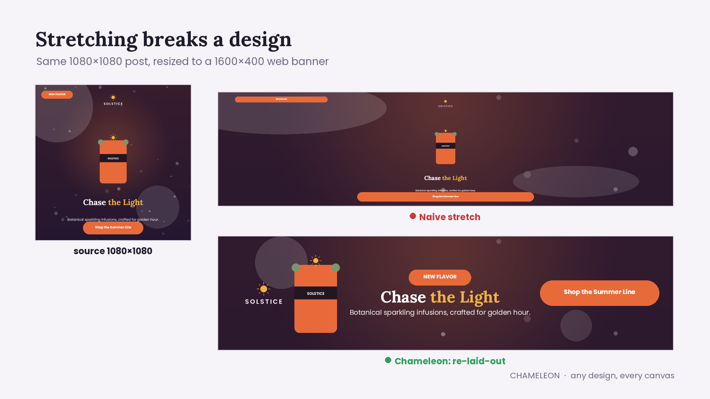

# CHAMELEON — a resize engine that moves the furniture

Give it a finished design and a target canvas; it returns the same elements re-laid-out
for the new shape — re-stacked, re-flowed, re-balanced — not stretched or letterboxed.
Deterministic, offline, no model: typically 1–150 ms per design (≤ 0.5 s for a dense
60-element design; the first call also loads the fonts, ~1 s). All logic is in
[`engine/resize.py`](engine/resize.py).



## Run it

```bash
pip install -r requirements.txt          # Python 3.10+; no new dependencies were added
python -m engine.main                    # every input/*.json -> output/<task>_output.{json,png}
python -m tests.test_engine              # 10 designs x 20 real formats, every hard rule asserted

docker build --platform linux/amd64 -t chameleon .
docker run --rm --network none -v "$(pwd)/input:/app/input" -v "$(pwd)/output:/app/output" chameleon

python -m engine.server                  # optional: HTTP engine + browser viewer at :8787/viewer/
```

Beyond the scored engine: an **Adobe Express add-on** ([`addon/`](addon/README.md)) that
resizes the page you're editing into real, editable pages; the **HTTP service** it talks to
([`engine/server.py`](engine/server.py)); a one-minute **demo video**
([`demo/chameleon_demo.mp4`](demo/chameleon_demo.mp4), regenerated by `demo/make_demo.py`);
and a one-page **[pitch](PITCH.md)**.

## How it works

**1. Analyse — no semantic labels needed.** Elements become *units* that travel together:
explicit `group_id`s; ungrouped text sitting on an opaque shape (a button); a small sticker
riding on a picture (a price tag on a bottle); a short caption right under a picture. Full-canvas
art is *background*; content-free shapes are *decoration*; a big rectangle behind content is a
*panel* that is later re-wrapped around it; thin shapes are *rules*. Importance comes from type,
font size, area and position: the largest type is the headline, the top-most small picture is the
logo, the largest picture the hero, the largest button the CTA, small type hugging the bottom is
fine print, rotated or corner-hugging small units are *pins* (stickers/badges that keep their
corner). Images are measured by their **visible pixels** (alpha bounds), so transparent padding
never distorts spacing — but it is still kept inside the canvas.

**2. Order.** An XY-cut recovers reading order, which units sit side by side (a row of badges or
products), and the column each unit was aligned in (left / centre / right within its column).

**3. Lay out** by target shape:

| target | layout | what happens |
|---|---|---|
| portrait / square | **stack** | rows top-to-bottom in reading order, spaced in the source's own vertical rhythm; the hero may grow on taller canvases |
| landscape (1.25–2.4) | **split**, scored against stack | the hero (or a whole row of products) on one side, everything else as a stacked column |
| banner (≥ 2.4) | **row** | pictures │ text stack │ CTA, vertically centred, pictures yield width before anything is dropped |

Each layout binary-searches the largest scale that fits. Text is measured with the
renderer's **own fonts and greedy wrap**, so every line break in the JSON is exactly the one
the PNG shows; multi-line text uses *balanced* wrapping (no one-word widows); text boxes are
shrink-wrapped with one space of slack so the renderer cannot re-wrap them. Buttons that get
narrow keep a legible label: padding tightens, the label wraps, the pill grows taller.

**4. Degrade gracefully.** Every text has a legibility floor relative to the canvas. When
something would fall below it, the least important unit (fine print → stickers → badge rows →
subheads …) drops out — but only if that actually buys legibility, and never the headline or
logo. Stickers on a picture that has become too small to read hide while the picture stays.

**5. Finish.** Backgrounds go full-bleed with `fit: cover` (crop, never stretch); decorations
keep their relative anchor (an opaque one shrinks off text it never touched); panels re-wrap
their content and stay off units they never covered (a white logo never lands on a light card);
everything is clamped inside the canvas, rotation included.

## Hard rules, and how they're honoured

- Same ids, same count; nothing added. `content` and `font_family` never change; only
  `font_size` (integers, so measurement = rendering) and geometry do.
- Images scale uniformly (aspect preserved); only full-bleed `cover` art crops. No pixel is
  ever generated or edited.
- Nothing off-canvas — including the rotated bounds of rotated elements.
- **Dropped / missing-asset elements are hidden explicitly** (`opacity: 0`; text also gets a
  transparent colour, because the renderer ignores text opacity) and kept in-canvas. An element
  that was entirely off-canvas in the source stays invisible.
- `resize()` never raises: if no layout is possible it falls back to a valid letterbox (in
  testing, only degenerate canvases such as 1×1 or 7×900 ever reach it).

## Evidence

- `tests/test_engine.py` — the 3 samples + 7 stress designs in `tests/designs/` (landscape and
  story sources, left-aligned text-only, three products with price stickers and captions,
  a card panel with dark text, a missing hero asset, a 52-letter word and a long URL, empty /
  zero-size / off-canvas elements, rotated text, five variable badges, an unknown font, no
  background) × 20 real formats (Instagram, Story, Facebook, X, YouTube, LinkedIn, Pinterest,
  IAB 728×90 / 970×250 / 300×250 / 160×600 / 300×600 / 320×50, A4, slides, email). Asserts ids,
  in-canvas, proportions, unchanged copy, and that the renderer's wrap fits every text box.
- Fuzzed with 1,500 random designs (random types, overlaps, rotations, groups, fonts, missing
  assets) — no crashes, no fallbacks, no rule violations.

## Trade-offs

- **No model, on purpose.** Stage one runs offline in a `linux/amd64` container on an Apple
  M5 Pro (emulated); a heuristic engine is fast, reproducible and debuggable, and the core of
  this problem is geometry and typography rather than language. A local vision model would be
  most useful for role labelling and focal-point cropping — a natural next step.
- Thresholds (legibility floors, layout cut-offs, gaps) were tuned on the samples and the
  synthetic designs, never on a specific design or size.
- Extreme banners drop secondary copy rather than shrinking everything into unreadable text.
  An unbreakable word (the 52-letter one) can only shrink until it fits — copy is fixed in
  stage one.
- Finale directions this leaves room for: offering several candidate layouts (the engine
  already scores them), letting users lock/pin units, rewriting copy to fit.
